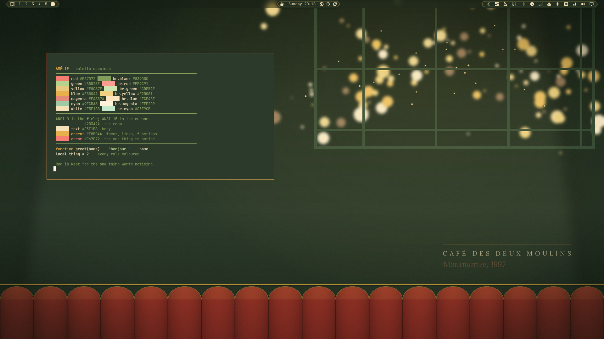
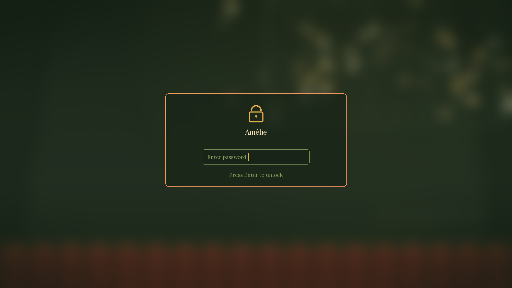

# Amélie



An Omarchy theme after Jeunet's film. Delbonnel lit Montmartre in green and gold
and held red back for the few objects that carry the story; the palette works
the same way here. Onyx green field, wheat light, brass chrome, and the café
awning's red kept for the one thing that should be noticed: errors, attention
marks and the active window border.

The film's pleasure is in small tactile things, and the theme is built out of
them: brass, enamel, lamplight, and a green that is always a room.

## Screenshots

The preview above is the specimen from `scripts/specimen.py` in a 720x400
terminal over the theme's own wallpaper, with the bar above it.



`preview-unlock.png` is rendered from the `[lock]` section of `shell.toml`, not
captured: locking a session to photograph it needs the password to get back, so
`scripts/make-lock-preview.py` draws the card over the actual wallpaper.

Captures of running apps are not committed — they show whatever is installed on
the machine that took them. `scripts/capture-screenshots.sh` makes them on
demand: `preview.png`, `screenshots/tiled.png` (btop, lazygit, Neovim reading
`colors.toml`, and flea), `screenshots/floating.png` (flea over the same
layout), `screenshots/shell.png` (the menu) and `screenshots/notifications.png`
(a normal and a critical notification). It switches to the theme, captures, and
puts the previous theme back.

## Install

Clone anywhere and run the installer. It copies the theme into
`~/.config/omarchy/themes/amelie` without its `.git`, installs the fonts, the
four theme-set hooks and the Waterfox helper, then applies the theme:

```bash
git clone https://github.com/Binz120/amelie-theme ~/src/amelie-theme
~/src/amelie-theme/install.sh
```

`omarchy theme install https://github.com/Binz120/amelie-theme` also works, but
Omarchy strips anything from a cloned theme that can run code — `*.lua`, the
terminal configs and `vscode.json` — and regenerates them from `colors.toml`.
The colours survive; the theme's own `hyprland.lua` is byte-identical to what
the template generates, so what a clone-staged theme loses in practice is
nothing visible. The installer exists so the theme, its hooks and its font are
one command instead of four.

Update:

```bash
git -C ~/src/amelie-theme pull && ~/src/amelie-theme/install.sh
```

Remove:

```bash
~/src/amelie-theme/uninstall.sh
```

Backgrounds: `Super + Ctrl + Space` or `omarchy theme bg next`.

## Palette

Twelve anchors arrived as a list and are used directly; every other role walks
one of those anchors in OKLCH — same hue, different lightness and chroma —
because a dark theme cannot print `#A4161A` as text (1.56:1) and stay readable.

| Role | Colour | Anchor | Contrast on the field |
|---|---|---|---|
| Field (background) | `#2B3A2A` | Onyx | n/a |
| Panels (dark background) | `#212E20` | Onyx L 0.285 | n/a |
| Deepest chrome | `#182417` | Onyx L 0.245 | n/a |
| Body text (foreground) | `#F5E1B8` | Wheat Light | 9.39 |
| Cursor (bright foreground) | `#FFF9EA` | Wheat Light L 0.985 | 11.48 |
| Dim text (dark foreground) | `#76914C` | Green Olive L 0.62 | 3.40 (chrome) |
| Comments (muted) | `#839D5C` | Green Olive L 0.66 | 3.99 (chrome) |
| Accent: focus, links, functions | `#E8B04A` | Honey | 6.17 |
| Selection | `#2E5B34` | Military Green | 6.14 with wheat on it |
| Keywords | `#FEF2D9` | Wheat L 0.965 | 10.86 |
| Types | `#E8C87E` | Caramel L 0.845 | 7.46 |
| Numbers | `#E9C46A` | Saffron | 7.22 |
| Strings | `#B5D28E` | Green Olive L 0.825 | 7.22 |
| Parameters, properties | `#9ECBA6` | Military Green L 0.80 | 6.63 |
| Errors, deletions | `#F67D72` | Red Ruby L 0.725 | 4.65 |
| ANSI magenta | `#E4887A` | Rust L 0.72 | 4.65 |
| ANSI brown | `#885E41` | Black of Jay L 0.52 | 2.14 (chrome) |

Reds never carry body text below the error role. `#D64933` (vermillon) and the
values around it sit at 2.79:1 on the field, so they are used as surfaces and as
the border gradient stop, not as type — the bar's attention role uses the lifted
ruby at 5.48:1 on the bar instead.

Three roles are deliberately low-contrast chrome, and say so: `muted` (3.99) for
comments and placeholders, `dark_foreground` (3.40) for line numbers and ANSI 8,
and `brown` (2.14) for the eighth ANSI hue. Everything else clears 4.5 on both
the field and the panel. `scripts/audit.py` enforces that, and fails on a hex
literal in any hand-written config that is not a `colors.toml` role or a
documented extension.

## The border

`colors.toml` carries the awning as a two-stop gradient on the active window and
on grouped windows:

```toml
hyprland_active_border = "rgba(d64933ee) rgba(e8b04aee) 45deg"
hyprland_inactive_border = "rgba(2e5b34aa)"
```

Omarchy generates `hyprland.lua` from it with `{{ hypr_gradient … }}`; the theme
does not ship its own copy, so the border cannot drift from the palette.

## What the theme ships

| File | What it does |
|---|---|
| `colors.toml` | The palette. Omarchy generates terminals, Neovim, Helix, VS Code, fcitx5, the shell, the AI CLIs and GTK from it at staging. |
| `shell.toml` | The shell surfaces: bar two steps darker than the windows, awning gradient on popups, menus, notifications, launcher, polkit and the lock card. |
| `gtk.css` | GTK3/4 and libadwaita sheet: Lora on titles, menus and headerbars, sans body. Imported by `~/.config/gtk-4.0/gtk.css`. |
| `btop.theme` | Graphs warm from green to brass as they rise; heat burns honey-white. |
| `icons.theme` | `Yaru-sage-dark`. |
| `fastfetch.jsonc` | fastfetch layout in the theme palette: logo, hardware / software / age sections drawn in olive rules, keys in sage, honey and rust. |
| `starship.toml`, `lazygit.yml`, `fzf.sh` | Prompt, git TUI and fuzzy finder colours. |
| `zed.json`, `warp.yaml`, `vencord.theme.css` | Editor, terminal and Discord themes; each app imports its file by hand (see below). |
| `base24.yaml` | The palette in Base24 form, for any tool that consumes that spec. |
| `chromium.theme` | `43,58,42`. |
| `legacy/` | Colourings for the Omarchy 2.x / 3.x apps that were replaced by the shell. Not staged by default; see `legacy/README.md`. |
| `backgrounds/` | One still, `1.jpg` (2560x1440), and its intro clip `intros/1.mp4`. |
| `fonts/` | Lora Regular and Italic (SIL OFL 1.1), installed by `install.sh`. |
| `hooks/`, `extras/` | The theme-set hooks and the Waterfox generator, installed by `install.sh`. |
| `preview.png`, `preview-unlock.png` | Theme-picker previews: the desktop, and the lock card rendered from `shell.toml`. |

Omarchy generates the files the theme does not repeat: terminals (four), Neovim,
Helix, VS Code, fcitx5, Obsidian, keyboard backlight, and the AI CLI configs.

## Apps outside Omarchy's own theming

Installed as theme-set hooks by `install.sh`:

| App | What happens on every `omarchy theme set` |
|---|---|
| lazygit | `~/.config/lazygit/config.yml` links to the active theme's `lazygit.yml` |
| starship | `~/.config/starship.toml` links to the active theme's `starship.toml` |
| fzf | `~/.config/fzf/omarchy-theme.sh` is rewritten; source it once from your shell rc |
| fastfetch | `~/.config/fastfetch/config.jsonc` links to the active theme's `fastfetch.jsonc` |
| Vencord / Vesktop | copies `vencord.theme.css` into `~/.config/Vencord/themes/omarchy.theme.css` |
| Waterfox | repaints `userChrome.css` and `userContent.css` in every profile |

Imported by hand, because the app owns the file:

```bash
# Zed: copy into ~/.config/zed/themes/ and pick "Amélie"
cp ~/.local/state/omarchy/current/theme/zed.json ~/.config/zed/themes/

# Warp: copy into ~/.warp/themes/
mkdir -p ~/.warp/themes && cp ~/.local/state/omarchy/current/theme/warp.yaml ~/.warp/themes/
```

Steam is not covered: neither Omarchy nor Steam exposes a palette hook a theme
can write, so a `steam.css` here would be decoration.

## Waterfox

Waterfox is Firefox-derived, so it reads `userChrome.css` rather than a single
colour value. `extras/omarchy-waterfox-theme` renders `userChrome.css` and
`userContent.css` from the active theme into every profile that has a
`prefs.js`, and appends the four prefs that let chrome stylesheets load:
`toolkit.legacyUserProfileCustomizations.stylesheets`, both `browser.theme.*`
prefs, and `ui.systemUsesDarkTheme`. `install.sh` puts it in `~/.local/bin` and
installs the hook; Waterfox reads the CSS at startup, so quit and reopen it
after a theme change.

## The wallpaper

`backgrounds/1.jpg` is drawn from `colors.toml` by `scripts/make-background.py`
(Pillow, fixed seed): the onyx room, a café window of brass bokeh behind its
mullions, the awning's scalloped valance along the bottom and the café name
tracked in the corner. It is reproducible and carries no third-party image.

`backgrounds/intros/1.mp4` is the still with a slow push-in that resolves to it
exactly, rendered by `scripts/make-intro.sh` (ffmpeg, six seconds, silent). The
shell crossfades into the still, so no fade of its own is needed.

## Development

```bash
scripts/verify.sh          # palette audit, config parsing, a real staging run
scripts/verify.sh --fast   # skip the staging run (CI does this)
scripts/audit.py           # contrast floors and colour provenance
scripts/make-background.py --help
scripts/make-intro.sh
python3 scripts/specimen.py   # the sheet in preview.png
scripts/make-lock-preview.py  # preview-unlock.png
scripts/capture-screenshots.sh [--opaque]   # the README captures, on your own session
```

`scripts/verify.sh` stages the theme twice in a throwaway `HOME` — once with a
`.git` directory and once without — and fails unless both trees are
byte-identical. That is what keeps the clone and the installer from drifting
apart.

CI runs the fast checks on every push (`.github/workflows/check.yml`).

## Verified

```
scripts/verify.sh --fast          → 0 failures
scripts/verify.sh                 → 0 failures, clone and local staging identical
scripts/audit.py                  → 22 roles on the published floors, no stray hex
grep '{{' in the staged theme     → none
general:col.active_border         → eed64933 eee8b04a 45deg
```

## Credits and licence

Theme, code and generated wallpaper: MIT (see `LICENSE`). Lora is by the Lora
Project Authors under the SIL Open Font License 1.1 (`fonts/OFL.txt`). Icons are
`Yaru-sage-dark` from the Yaru project, and are not redistributed here.
